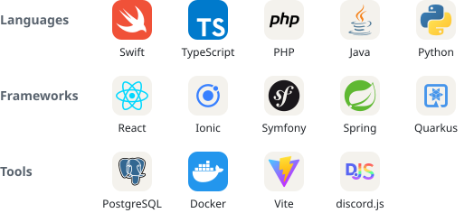

<picture>
  <source media="(prefers-color-scheme: dark)" srcset="assets/banner-dark.svg">
  
</picture>

  <samp>
    <a href="#projects">projects</a> ·
    <a href="#stack">stack</a> ·
    <a href="mailto:robertwalter2003@proton.me">mail</a> ·
    discord: robert_wlt
  </samp>

## About

Junior developer at <a href="https://www.pccaddie.de"><picture><source media="(prefers-color-scheme: dark)" srcset="assets/pc-caddie-dark.svg"></picture></a>, where I work on software for golf clubs. I studied computer science in a dual programme and have been working full-time since April 2026.

In my spare time I build things I want to use myself, like a macOS app that shows where your storage goes and a Discord bot you set up in the browser.

## Projects

<table>
  <tr>
    <td width="50%" valign="top">
      
      <h3><a href="https://github.com/Robertwlt03/storage-manager">storage-manager</a></h3>
      
Shows where the storage on your Mac goes, including what macOS lumps together as “System Data”. Available in 28 languages, and nothing leaves your Mac.

      <picture>
        <source media="(prefers-color-scheme: dark)" srcset="assets/tags-storage-manager-dark.svg">
        
      </picture>
    </td>
    <td width="50%" valign="top">
      
      <h3><a href="https://github.com/Robertwlt03/NexoBot">Nexo</a></h3>
      
Discord bot for moderation, tickets, levels, music and giveaways, set up in a web dashboard. Every member gets a profile card that works on every server running Nexo.

      <picture>
        <source media="(prefers-color-scheme: dark)" srcset="assets/tags-nexo-dark.svg">
        
      </picture>
    </td>
  </tr>
</table>

## Stack

What I've been using lately.

<picture>
  <source media="(prefers-color-scheme: dark)" srcset="assets/stack-dark.svg">
  
</picture>

## Off the clock

<picture>
  <source media="(prefers-color-scheme: dark)" srcset="assets/tags-hobbies-dark.svg">
  
</picture>
