<picture>
  <source media="(max-width: 500px)" srcset="assets/pictures/intro-phone.svg">
  <source media="(prefers-color-scheme: dark)" srcset="assets/pictures/intro-dark.svg">
  
</picture>

## About

Junior developer at&nbsp; 

I work on software for golf clubs. I studied computer science in a dual study program and have been working full-time since
April 2026.

## Projects

Two apps and my Claude skills, then the libraries that other projects can use too. Every card opens its repository.

<!-- projects -->
<a href="https://github.com/Robertwlt03/storage-manager"><picture><source media="(max-width: 500px)" srcset="assets/pictures/project-storage-manager-phone.svg"><source media="(prefers-color-scheme: dark)" srcset="assets/pictures/project-storage-manager-dark.svg">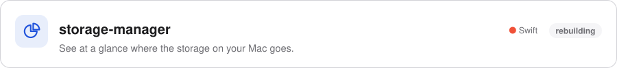</picture></a>

<a href="https://github.com/Robertwlt03/nexo-bot"><picture><source media="(max-width: 500px)" srcset="assets/pictures/project-nexo-bot-phone.svg"><source media="(prefers-color-scheme: dark)" srcset="assets/pictures/project-nexo-bot-dark.svg">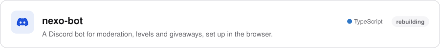</picture></a>

<a href="https://github.com/Robertwlt03/claude-skills"><picture><source media="(max-width: 500px)" srcset="assets/pictures/project-claude-skills-phone.svg"><source media="(prefers-color-scheme: dark)" srcset="assets/pictures/project-claude-skills-dark.svg">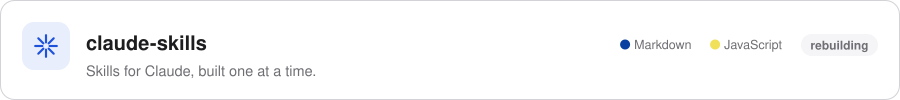</picture></a>

<a href="https://github.com/Robertwlt03/check-pipeline"><picture><source media="(max-width: 500px)" srcset="assets/pictures/project-check-pipeline-phone.svg"><source media="(prefers-color-scheme: dark)" srcset="assets/pictures/project-check-pipeline-dark.svg"></picture></a><a href="https://github.com/Robertwlt03/markdown-graphics"><picture><source media="(max-width: 500px)" srcset="assets/pictures/project-markdown-graphics-phone.svg"><source media="(prefers-color-scheme: dark)" srcset="assets/pictures/project-markdown-graphics-dark.svg">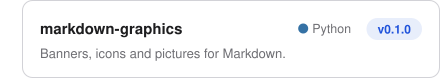</picture></a>

<a href="https://github.com/Robertwlt03/console-look"><picture><source media="(max-width: 500px)" srcset="assets/pictures/project-console-look-phone.svg"><source media="(prefers-color-scheme: dark)" srcset="assets/pictures/project-console-look-dark.svg"></picture></a><a href="https://github.com/Robertwlt03/swift-app-bundler"><picture><source media="(max-width: 500px)" srcset="assets/pictures/project-swift-app-bundler-phone.svg"><source media="(prefers-color-scheme: dark)" srcset="assets/pictures/project-swift-app-bundler-dark.svg"></picture></a>

<a href="https://github.com/Robertwlt03/swiftui-sunburst"><picture><source media="(max-width: 500px)" srcset="assets/pictures/project-swiftui-sunburst-phone.svg"><source media="(prefers-color-scheme: dark)" srcset="assets/pictures/project-swiftui-sunburst-dark.svg">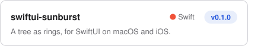</picture></a><a href="https://github.com/Robertwlt03/file-tree-kit"><picture><source media="(max-width: 500px)" srcset="assets/pictures/project-file-tree-kit-phone.svg"><source media="(prefers-color-scheme: dark)" srcset="assets/pictures/project-file-tree-kit-dark.svg">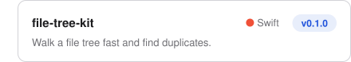</picture></a>

<a href="https://github.com/Robertwlt03/index-store-reader"><picture><source media="(max-width: 500px)" srcset="assets/pictures/project-index-store-reader-phone.svg"><source media="(prefers-color-scheme: dark)" srcset="assets/pictures/project-index-store-reader-dark.svg"></picture></a>
<!-- /projects -->

## Stack

The languages, frameworks and tools I'm using right now, at work and at home.

<!-- stack -->
<picture><source media="(prefers-color-scheme: dark)" srcset="assets/pictures/stack-row-languages-dark.svg"></picture> <a href="https://www.swift.org"><picture><source media="(prefers-color-scheme: dark)" srcset="assets/pictures/stack-swift-dark.svg">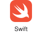</picture></a><a href="https://www.typescriptlang.org"><picture><source media="(prefers-color-scheme: dark)" srcset="assets/pictures/stack-typescript-dark.svg"></picture></a><a href="https://www.php.net"><picture><source media="(prefers-color-scheme: dark)" srcset="assets/pictures/stack-php-dark.svg"></picture></a><a href="https://dev.java"><picture><source media="(prefers-color-scheme: dark)" srcset="assets/pictures/stack-java-dark.svg"></picture></a><a href="https://www.python.org"><picture><source media="(prefers-color-scheme: dark)" srcset="assets/pictures/stack-python-dark.svg">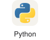</picture></a><a href="https://developer.mozilla.org/en-US/docs/Web/JavaScript"><picture><source media="(prefers-color-scheme: dark)" srcset="assets/pictures/stack-javascript-dark.svg"></picture></a><a href="https://www.gnu.org/software/bash/"><picture><source media="(prefers-color-scheme: dark)" srcset="assets/pictures/stack-shell-dark.svg">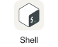</picture></a>

<picture><source media="(prefers-color-scheme: dark)" srcset="assets/pictures/stack-row-frameworks-dark.svg"></picture> <a href="https://react.dev"><picture><source media="(prefers-color-scheme: dark)" srcset="assets/pictures/stack-react-dark.svg">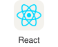</picture></a><a href="https://ionicframework.com"><picture><source media="(prefers-color-scheme: dark)" srcset="assets/pictures/stack-ionic-dark.svg">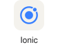</picture></a><a href="https://symfony.com"><picture><source media="(prefers-color-scheme: dark)" srcset="assets/pictures/stack-symfony-dark.svg">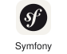</picture></a><a href="https://spring.io"><picture><source media="(prefers-color-scheme: dark)" srcset="assets/pictures/stack-spring-dark.svg">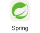</picture></a><a href="https://quarkus.io"><picture><source media="(prefers-color-scheme: dark)" srcset="assets/pictures/stack-quarkus-dark.svg"></picture></a>

<picture><source media="(prefers-color-scheme: dark)" srcset="assets/pictures/stack-row-tools-dark.svg"></picture> <a href="https://www.postgresql.org"><picture><source media="(prefers-color-scheme: dark)" srcset="assets/pictures/stack-postgresql-dark.svg"></picture></a><a href="https://www.docker.com"><picture><source media="(prefers-color-scheme: dark)" srcset="assets/pictures/stack-docker-dark.svg"></picture></a><a href="https://vite.dev"><picture><source media="(prefers-color-scheme: dark)" srcset="assets/pictures/stack-vite-dark.svg"></picture></a><a href="https://discord.js.org"><picture><source media="(prefers-color-scheme: dark)" srcset="assets/pictures/stack-discordjs-dark.svg"></picture></a>
<!-- /stack -->

## Outside of work

<!-- hobbies -->
<picture><source media="(prefers-color-scheme: dark)" srcset="assets/pictures/hobbies-1-dark.svg"></picture> <picture><source media="(prefers-color-scheme: dark)" srcset="assets/pictures/hobbies-2-dark.svg"></picture> <picture><source media="(prefers-color-scheme: dark)" srcset="assets/pictures/hobbies-3-dark.svg"></picture> <picture><source media="(prefers-color-scheme: dark)" srcset="assets/pictures/hobbies-4-dark.svg"></picture> <picture><source media="(prefers-color-scheme: dark)" srcset="assets/pictures/hobbies-5-dark.svg"></picture> <picture><source media="(prefers-color-scheme: dark)" srcset="assets/pictures/hobbies-6-dark.svg"></picture>
<!-- /hobbies -->

## Contact

<!-- contact -->
<a href="mailto:robertwalter2003@proton.me"><picture><source media="(prefers-color-scheme: dark)" srcset="assets/pictures/contact-1-dark.svg"></picture></a> <a href="https://discord.com/users/566171890339545090"><picture><source media="(prefers-color-scheme: dark)" srcset="assets/pictures/contact-2-dark.svg"></picture></a> <a href="https://www.instagram.com/robert_wlt03/"><picture><source media="(prefers-color-scheme: dark)" srcset="assets/pictures/contact-3-dark.svg"></picture></a>
<!-- /contact -->
